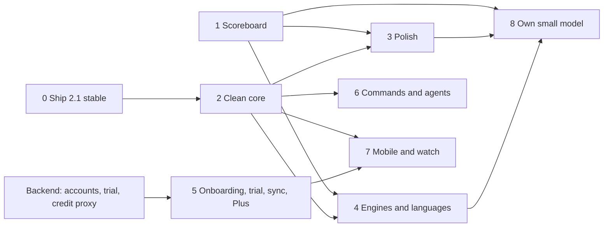

# Voicetypr Master Plan

Status: ACTIVE, written 2026-11-12 from the founder's decisions of that day and
the code audit of `release/2.1.0-beta.8` (`5d908536`). It replaces the phase
order of [the Q4 2026 plan](archive/MASTER-PLAN-2026-Q4.md), which stays as
history: its validation numbers, live-preview research and evidence index are
still valid reference, its ordering is not. Numbered plans stay valid unless
[Older plans](#older-plans) says otherwise.

## North star

> Speak messily → get the text you meant, in the right shape for where the
> cursor is → spend no time fixing it.

Every phase is judged on the same numbers, measured on our own real-speech
sets (Phase 1), never on vendor benchmarks or synthetic clips:

| Metric | Meaning |
|---|---|
| Accepted without edit | Share of dictations the user keeps unchanged |
| Hard-word accuracy | Names, products, jargon, code identifiers spelled right |
| Meaning-change errors | Polish changed facts, numbers, hedges, or answered the dictation. Target: zero |
| Stop → text (p50/p95) | Time from releasing the hotkey to text at the cursor |
| Insertion success | Text actually landed in the target app, clipboard restored |
| Install → first kept dictation | Share of installs that reach one kept dictation, and how long it takes |
| Trial start → paid | Share of started trials that buy |

## What we compete on

1. **The final text.** Polish that understands intent, destination and tone is
   the product. Recognition is an input to it.
2. **Private and professional on Mac and Windows.** Local engines work offline;
   nothing is logged that identifies what the user said or where.
3. **Languages others do badly**, Bangla and the other Indic languages first.
4. **The voice layer for any AI agent**, not tied to one vendor.

We do not compete on being free. There is a trial, then the user pays.

## Principles

1. **Polish is the product.** Every Polish change is measured on real speech
   before it ships.
2. **Faithful by default.** Keep the speaker's words, names, numbers and
   hedges. Never answer a dictated question. Tone follows the user, not us.
3. **CLI-first.** Every feature lives in a core with no Tauri dependency and is
   reachable from the CLI with `--json`. The desktop app, the tests and the
   mobile apps are thin layers over that core.
4. **Local and cloud both.** Local gives private, offline recognition and basic
   cleanup. Cloud gives the best recognition and the best Polish.
5. **Evidence gate.** Nothing ships as "better" without before/after numbers.
6. **The privacy rule is enforced by code** (a scrubber at the log sink and a
   CI check), not by review.
7. **Show the value before asking for anything.** No sign-in, payment or trial
   clock before the user has seen their own messy speech come out clean.
8. Refactors are separate from behaviour changes. Do not grow the oversized
   files listed in `docs/ARCHITECTURE.md`.

## Packaging and pricing (founder decisions)

- **Trial.** Starts only when the user clicks "Start trial", after their first
  working dictation. Starting it needs an account (email + one-time code, no
  password). The trial includes a small managed-cloud credit so cloud
  recognition and Polish can be tried without an API key.
- **Core, one-time.** $39 for 1 device today. With mobile the entry tier
  becomes 2 devices at $59–69. One year of updates; the app keeps working
  after that. Includes local engines, live preview, vocabulary, cloud
  recognition and Polish with the user's own keys, and local Polish once
  shipped. A paid Core license keeps working offline (90-day grace today).
- **Plus, subscription.** $9/month; yearly $79 or $90. Includes Core. Managed
  cloud recognition and Polish paid from monthly credits, top-ups, sync across
  devices, mobile.
- Not VC-backed: default managed engines must be cheap per hour; premium
  engines cost more credits.

## Phase map

| Phase | Goal | Ships as | Needs first | Status |
|---|---|---|---|---|
| 0 | 2.1 stable that we trust | 2.1.0, before 2027-01-15 | — | In progress (beta.8 merged, beta.9 open) |
| 1 | A scoreboard on real speech | Internal | Founder recordings | Partly built |
| 2 | Clean core, CLI-first | 2.2 betas | Phase 0 branch cut | Not started |
| 3 | Polish that understands intent, place and tone | 2.2 | 1, 2 | Partly built |
| 4 | Engines and languages (Gemini, Muse, Indic) | 2.2–2.3 | 1; wiring needs 2 | Not started |
| 5 | Accounts, onboarding, trial, sync, Plus | 2.2–2.3 | Backend track | Not started |
| 6 | Voice commands and agents | 2.3 | 2 | Not started |
| 7 | Mobile (Expo, iOS + Android) and watch | Mobile 1.0 | 2, 5 | Not started |
| 8 | Our own small Polish model | Separate beta | 1, 3, 4 | Plan only ([084](084-local-polish-model.md)) |

### Tracks that can run at the same time

| Track | Work | Can start | Collides with |
|---|---|---|---|
| A Release | Phase 0 | Now | Everything in `src-tauri/src` until 2.1 is cut |
| B Scoreboard | Phase 1 capture tool, sets, harness | Now | Nothing (new files, CLI only) |
| C Backend | Accounts, trial start, credit proxy on `api.voicetypr.com` (not in this repo) | Now | Nothing in this repo |
| D Core | Phase 2 | When the 2.1 stable branch is cut | Any other work in `commands/audio.rs`, `commands/settings.rs`, `remote/` |
| E Engines | Phase 4 engine clients as new files, run through the CLI on the recording set | Now as spikes; wiring after D | D during wiring |
| F Onboarding | Phase 5 desktop flow | When C has `/trial/start` | `src/components/onboarding` only |
| G Mobile | Phase 7 Expo shell and keyboard spikes | When C has sign-in | Nothing in this repo (new repo or folder) |

Rules for every slice: one git worktree per slice; claim the row in
[`README.md`](README.md) first; nothing is pushed or released without the
founder's OK; hardware-dependent claims stay `NEEDS-SMOKE` until run.

### Repositories and branches (decided 2026-11-13)

- **Three repositories, not one.** This repo (desktop app and the shared core,
  public, AGPL), `voicetypr-web` (website and backend, private, already a pnpm
  + turbo workspace), and later a mobile repo. Merging them would put private
  server code next to public code, make every CI run and every agent's context
  bigger, and buy nothing: the only thing they share is the HTTP contract.
  That contract lives as one versioned schema file in `voicetypr-web`, and
  this repo pins a copy.
- **One integration line for 2.1:** branch `release/2.1.0-beta.9` in the
  worktree `worktrees/voicetypr-2.1`. Slices branch from it and merge back
  into it. `hotfix/2.0.12` is the stable line. Everything else is history.
- Stale worktrees were removed on 2026-11-13 (29 → 9 before the Phase 0
  slices); their branches were kept. Only `hotfix/2.0.12` (spoken
  punctuation) held work missing from the 2.1 line.

## Phase 0 — Ship 2.1 stable

Goal: 2.1.0 before 2027-01-15, with the audit's privacy, security and release
problems closed. Beta scope is [plan 087](087-2.1-beta8-beta9.md); beta.9 is
the last beta.

| # | Work | Proof of done |
|---|---|---|
| 0.1 | Beta.9 scope from 087: text around the cursor when Polish is on, CLI warm lifecycle, clipboard receipts | 087 acceptance |
| 0.2 | Port spoken punctuation from `hotfix/2.0.12` (six commits, not on any 2.1 branch) | Same behaviour as 2.0.12 on the 2.1 line |
| 0.3 | **Privacy sweep.** One scrubber where logs are written and where sidecar stderr is forwarded (`parakeet/sidecar.rs:170-185`), plus a CI check. Then remove the known leaks: recognized tokens (`sidecar/parakeet-swift/Sources/main.swift:2858`), the leftover `test_transcription_event` command (`commands/debug.rs:55`, `lib.rs:1273`), custom AI endpoint URL (`commands/ai.rs:774`, `:1377`), absolute paths (`lib.rs:756-767`, `whisper/cache.rs:69-106`, `whisper/manager.rs:294`, `commands/utils.rs:74-95`), device and server names (`commands/audio.rs:5817`, `audio/device_watcher.rs:103-147`), remote error bodies in history (`remote/client.rs:635-644`) | CI fails on a log line carrying a path, URL or transcript text; a real dictation session's log contains none |
| 0.4 | OpenCode 1.x receives dictated text as a process argument (`ai/agent_cli/private_input.rs:177`): require OpenCode 2.x (ACP) or warn in the UI | Dictated text not visible in the process list |
| 0.5 | **Release gate.** `release.yml` refuses a commit without green CI; `scripts/release-windows.ps1` runs the same installer checks as CI and fails on upload errors; sidecar `build.sh` fails when its protocol check fails | A red commit cannot be published |
| 0.6 | **Bugs.** Diarized file upload skips the writing pipeline and can send a second paid request (`commands/audio.rs:7700-7742`, `:7922`); settings saves can land out of order (`SettingsContext.tsx:84`, `commands/settings.rs:857`); unbounded cloud audio queue (`cloud_stt/soniox_ws.rs:104`, `deepgram_ws.rs:107`); legacy sharing password deleted before migration is confirmed (`commands/settings.rs:998`); Whisper download has no stall timeout (`whisper/manager.rs:297`) | A reproduction for each, failing before and passing after |
| 0.7 | **Security, small.** `/status` without a password stops returning hostname and device hash (`remote/http.rs:522`); the pill window gets its own minimal capability file (`capabilities/default.json`) | Checked on a second machine; pill still works |
| 0.8 | **Hygiene.** Delete merged local branches and stale worktrees (67 and 28 on 2026-11-12); reconcile ledger rows 075, 076, 079–081, 086 and the 133 unchecked `SMOKE.md` items against the code; stop Vitest collecting `agent/`; README claims (Parakeet "Mac-only", sharing "authenticated") | Ledger and smoke list match the code |

Not in 2.1: encryption for network sharing (Phase 4), the `audio.rs` split
(Phase 2).

## Phase 1 — Scoreboard (starts now)

Goal: one honest scoreboard that every later phase is judged against. Today
there are 212 invented Polish cases in `perf-corpus/polish/golden.jsonl` and a
hidden `voicetypr polish-eval` command.

A private real-speech set now exists outside the repo, at
`oss/voicetypr-test-audio/founder-dictation/`: 654 of the founder's own
dictations (8.7 hours, 16 kHz WAV, 2026-10-31 to 2026-11-13) with what the
engine recognized at the time. All are English, all went into AI assistants
and agents, none used Polish. They are unlabelled: the recognized text is not
a correct reference. The app keeps roughly two weeks of recordings, so copy
new ones into the set regularly.

| # | Work | Proof of done |
|---|---|---|
| 1.1 | **Label the founder set:** draft `reference_text` with the strongest cloud engine and `ideal_text` with a strong model, then the founder corrects a sample of 100. Needs the founder's OK first, because it sends his private dictations to those providers | 100 clips with a human-approved reference and ideal text |
| 1.2 | **Fill the gaps the founder set does not cover:** other destinations (chat, email, documents), other speakers and accents, German, Bangla, Hindi, mixed Bangla–English. Sources in order: beta users who opt in (1.5), public spontaneous-speech sets whose licence allows it (IndicVoices and Vaani for Indic; licences to be checked per set), and recordings we ask people to make | Each destination and language has at least 30 clips; set locked and versioned; never in the public repo |
| 1.3 | **Harness through the CLI:** engines × Polish providers → the north-star metrics, p50/p95, on an M-series Mac and a Windows laptop | One command prints the table |
| 1.4 | Human judgement for ambiguous Polish results; automatic checks only for hard failures | A second person can reproduce a verdict |
| 1.5 | Opt-in recording donation: separate consent, off by default, own storage, preview before sending, delete any time | Founder decision first |

## Phase 2 — Clean core, CLI-first

Goal: one dictation pipeline that the desktop app, the CLI, tests on any OS and
the mobile apps all call. This is the enabler for Phases 3, 4, 6 and 7.

Today: `commands/audio.rs` is 8,585 lines and `stop_recording_with_mode_at` is
one 1,842-line function; the record → recognize → write → deliver flow exists
in about seven variants; the writing pipeline and the Soniox and Deepgram
clients take a Tauri `AppHandle`.

| # | Work | Proof of done |
|---|---|---|
| 2.1 | A core crate with no Tauri dependency: capture → preprocess → recognize → vocabulary → Polish → deliver, with typed errors and explicit state. Seams are listed in the audit (`audio.rs` split) and [plan 050](050-structural-refactor.md), re-derived from current code | Core builds and its tests run on macOS, Windows and Linux CI |
| 2.2 | All seven flow variants (desktop mic, GUI upload, history retry, kept retry, CLI local, CLI remote, GUI remote) go through that one pipeline; the remote request is built in one place | One function per stage; no variant-specific copy |
| 2.3 | One engine interface that also covers remote and host-default engines; preview and request capabilities defined once; shared WebSocket client for Soniox and Deepgram | Adding an engine touches one new file and one registry line |
| 2.4 | Settings: validated partial patches instead of whole-object saves; one versioned migration that removes the legacy keys (`language`, `translate_to_english`, `show_pill_indicator`) | Two quick changes never lose one |
| 2.5 | **CLI parity:** every feature reachable with `--json`: full pipeline with vocabulary and Polish, settings, vocabulary, providers, per-stage timings | The Phase 1 harness runs only through the CLI |
| 2.6 | Split the other large files along the same stages: `cloud_stt/soniox.rs`, `ai/agent_cli.rs`, `remote/http.rs`, `commands/ai.rs`, `lib.rs` setup | No file in the oversized list |
| 2.7 | The design models a processing queue from the start, so a new recording can begin while earlier ones are still being recognized or polished | Back-to-back dictation works; results land in order |

Behaviour-preserving slices only; the same tests are green before and after
each slice. The stop path keeps its invariants (post-roll for user stops only,
`StopInFlightGuard`, the 8 s join timeout, recording generation).

## Phase 3 — Polish that understands intent, place and tone

Goal: the final text is what the user meant, shaped for where the cursor is.

Today Polish receives the app category (Chat, Email, Docs, Code, Terminal,
Social, Notes) and the user's per-app rules. It does not see text around the
cursor (beta.9 adds it) and knows nothing about the user's tone.

| # | Work | Proof of done |
|---|---|---|
| 3.1 | **Context:** text before and after the cursor, selected text, the kind of field, the app, vocabulary. Collected with permission, sent only to the Polish provider the user chose, never logged | Hard-word accuracy and accepted-without-edit go up on the set |
| 3.2 | **Destination shapes:** chat message, email, document, code comment, commit message, terminal command, prompt for an AI agent. Each has rules for length, structure and what must stay literal. The "AI apps" category (founder's name for it) was added 2026-11-13, so ChatGPT, Claude and desktop agent apps now get a prompt hint. Still open: an agent running in a terminal gets the "literal command line" hint, which is wrong for a prompt (`writing/app_category.rs`). All 654 clips in the founder set are this destination | Per-destination cases in the set pass |
| 3.3 | **Tone:** learned per app from what the user keeps and what they fix after insertion; stored locally; visible and resettable. "Keep my words" stays as the opt-out | The same sentence comes out in the user's register in two different apps |
| 3.4 | **Guards:** never change meaning, never answer; skip Polish when the text is already clean; one key swaps back to the raw transcript | Zero meaning-change errors on the set |
| 3.5 | **Vocabulary engine:** terms with spoken aliases and scope (global, app, project); short relevance-ranked lists per dictation; recognition-time biasing per engine; learn a fix when the user retypes a word, with undo | Hard-word accuracy per engine before and after |
| 3.6 | **Speed:** polish finished sentences while the user is still speaking on long dictations; fast default models; prompt order that lets provider caching apply | Stop → text p50/p95 before and after |
| 3.7 | **Audio-native path:** compare "one audio model that outputs clean text" (Phase 4.1) with "recognizer + Polish" on the same clips, and use whichever wins per language | The comparison table |

## Phase 4 — Engines and languages

| # | Work | Proof of done |
|---|---|---|
| 4.1 | **Gemini 3.5 Transcribe** (`gemini-3.5-transcribe` for files, `gemini-3.5-transcribe-live` for streaming): cleanup built in, up to 1,000 vocabulary phrases, 85+ locales | On the scoreboard; shipped as a bring-your-own-key engine if it wins anywhere |
| 4.2 | **Meta Muse Voice Transcribe** (`wss://api.meta.ai/v1/asr/realtime`): 25 languages including Bengali, Hindi, Kannada, Marathi, Tamil and Telugu; keywords; no formatting, so it always pairs with Polish | Same |
| 4.3 | **Indic track** (see below) | Bangla and Hindi rows on the scoreboard beat today's default |
| 4.4 | FluidAudio 0.17.4 → 0.18.x; Parakeet Ultra option | Real-speech numbers before and after |
| 4.5 | **Network sharing over TLS** with a pinned key, body-size limits before the upload is buffered, and the host context lock no longer held for a whole transcription (`remote/client.rs:255`, `remote/http.rs:203`, `:765`) | Password and audio not readable on the LAN; needed before a phone can use a Mac as its engine |
| 4.6 | Live preview for the remaining engines, in the order from the archived plan's table | Preview text matches the final text's normalization |

Measured 2026-11-14 on the founder set (654 English dictations, M4 Pro, local
only; details in the set's `*-results.md`). No clip has a human reference yet,
so "differs from Whisper" is disagreement, not accuracy:

| Model | Runtime | Failed / empty | Mean words differing from Whisper | Speed | Live words on Mac |
|---|---|---|---:|---:|---|
| Parakeet V2 (today's default) | shipped sidecar | n/a | 12.6% | n/a | yes |
| Parakeet Ultra | MLX community conversion | 0 / 4 | 13.5% | 77× | as V3 (decode-ahead) |
| Fluid Speech Pro | MLX | 0 / 3 | 13.6% | 48× | as V3 |
| Qwen3-ASR 1.7B | MLX, 8-bit | 0 / 0 | 13.0% | 19× | no |
| Cohere Transcribe 03-2026 | PyTorch MPS, full precision | 1 / 0 | 17.7% (median 8.8%) | 20× | no |
| Nemotron 3.5 (shipped) | shipped sidecar | 0 / 4 | 20.1% | 58× | yes |

- The founder's own corrections, recovered by matching dictations to the
  messages he sent (ThreadLens, `sent_match.py`): 435 clips matched, 386 sent
  unchanged, 49 edited. Nearly all edits are product names and jargon. Of 28
  such words Parakeet V2 misheard, Cohere got 14 right, Whisper 12, Fluid 11,
  Ultra 10, Qwen 10, Nemotron 5. Small and biased against V2 by construction.
- Decisions: Nemotron stays a streaming choice for languages Parakeet lacks,
  not an English recommendation. Fluid Speech Pro is not adopted (a
  competitor's model, no measured gain); Parakeet Ultra is the neutral
  equivalent if labels show a gain. Qwen and Cohere could only be "final text
  only" engines and need a new runtime; decide after labels.
- Ideas from the founder, not scheduled: a personal dictionary seeded from his
  corrected words; an opt-in "dictated, may be misheard" note appended in AI
  apps.

### Indic track

Bangla and other Indic users get poor results from most dictation apps.
Research of 2026-11-12 is in
[`docs/reports/2026-11-12-audit/indic-and-watch.md`](../docs/reports/2026-11-12-audit/indic-and-watch.md);
none of it has been measured by us yet.

1. Put Bangla, Hindi and mixed Bangla–English clips in the Phase 1 set first;
   nothing below is chosen without them. Bangladesh and West Bengal speakers
   both, because providers list `bn-BD` and `bn-IN` separately.
2. **Cloud, measure in this order:** Soniox (already integrated; Bengali and
   Hindi, mixed-language, about $0.12/hour realtime, no realtime retention),
   Muse Voice Transcribe ($0.18/hour, mixed-language), Gemini 3.5 Transcribe
   (`bn-BD`, `bn-IN`, Hindi), Sarvam Saaras v3 (India-focused, ₹29.40/hour,
   retention terms not published).
3. **Local, measure in this order:** Mozilla.ai's Bengali fine-tune of Whisper
   large-v3-turbo (Apache-2.0; needs conversion to our Whisper format, not yet
   tried), BanglaASR (Whisper small, MIT), the Vaani models from ARTPARK–IISc
   (MIT, gated download; one of them streams). Ship winners as downloadable
   language packs on the existing Whisper engine. Not usable: Meta MMS
   (non-commercial licence); Qwen3-ASR and Voxtral do not list Bengali.
4. Output rules in the writing pipeline, each a user choice, not a guess:
   Bengali script or romanised; dari (।) or full stop; Bengali or Latin
   numerals; English names and technical terms left in Latin script. The same
   for Hindi (Devanagari or Latin) and Urdu.
5. Recommend the winning engine per language in onboarding when the user picks
   that language.

## Phase 5 — Accounts, onboarding, trial, sync, Plus

Goal: a new user reaches a working, impressive result fast, then chooses to
start the trial; we can reach people who try and leave; settings follow the
user across devices.

Today: onboarding is welcome → source → permissions → readiness → hotkey →
success. The trial is 3 days, starts on the first app launch, and is tied only
to a device hash the app sends (`lib.rs` startup check →
`commands/license.rs`); there is no account and no email. The backend is the
private `voicetypr-web` repo (`packages/api-core`); it has no sign-in, sends no
email, has no CI and is deployed by hand.

| # | Work | Proof of done |
|---|---|---|
| 5.1 | **Backend:** accounts (email + one-time code), `/trial/start` tied to account and device, existing licenses attached by purchase email; purchases stay with the current payment provider | A new and an existing user can both sign in |
| 5.2 | **Managed credit proxy:** recognition and Polish through our server, metered per account. First use: the trial's starter credit and the onboarding demo. Later: Plus. Recognition at Soniox's list price is about $0.12 per audio hour, so a few hours of starter credit costs us cents per trial; Polish cost per dictation must be measured | A user with no API key gets cloud recognition and Polish |
| 5.3 | **Onboarding, value first:** (1) one promise, (2) pick a source with the recommended one preselected and any download running in the background, (3) permissions and hotkey, (4) a guided messy sentence shown raw next to polished, (5) a second dictation into the user's own app, (6) "Start trial" with email, (7) home with three next steps. Dictations in steps 4–5 work before the trial exists, capped per device | Install → first kept dictation, measured before and after |
| 5.4 | **Trial starts on click**, not at launch; the device hash is kept only to stop repeated trials | Clock unchanged until the click |
| 5.5 | **Lifecycle email** with an opt-in checkbox at sign-up: a short sequence during the trial and one "what stopped you?" that replies to the founder | Trial start → paid, before and after |
| 5.6 | **Sync:** vocabulary, corrections, snippets, app rules, tone, hotkeys. Never audio or transcripts unless the user turns history sync on | Change on one device appears on the other |
| 5.7 | **Plus:** credit ledger, speed / quality / best modes, billing, top-ups, fair-use limits | First paid Plus user |
| 5.8 | **Provider terms:** Soniox ended free credits for new accounts in October 2025 and has no public partner programme, so the starter credit is ours to fund. Ask Soniox sales (and the Phase 4 winners) for volume pricing and for permission to resell usage through our proxy | Founder outreach; written terms either way |

Offline and enterprise buyers must still be able to activate without the
sign-in flow; keep a license-key path for them.

Status of 5.4 (2026-11-14, branch `feat/trial-click-start`, not merged): the
desktop half is built without accounts. The app reads `/trial/status` and
never starts a trial on its own; a device without one is `none`, which already
blocks dictation. "Start free trial" is on the last setup step and on the
License page and calls `/trial/start`; the pill and the tray say the trial has
not started instead of "Trial ended". This is not 5.3: nothing can be dictated
before the click, and there is no email. It must not ship before the
`voicetypr-web` branch `feat/trial-7-days-click-start` is deployed, because the
app has no fallback to the old `/trial/check`. `NEEDS-SMOKE`: the click in the
real app window (checked only in the UI preview and, for the two routes,
through the Rust client against a local copy of the API).

### Licensing: Polar decides, our API stays thin (decided 2026-11-13)

Polar already decides whether a key is valid and how many devices it may
activate; our database only remembers which Polar activation belongs to which
device, and holds the trial. So "Polar as the only licence authority" is a
cleanup, not a rebuild. Backend map and Polar research:
private backend notes and `docs/reports/2026-11-12-audit/polar-capabilities.md`.

- **The app keeps calling `api.voicetypr.com`, not Polar directly.** Installed
  versions call it for years, so those routes must stay anyway; a thin server
  lets us follow a Polar change without shipping an app update; and a paid
  license already works offline for 90 days, so our server being down does
  not lock anyone out.
- **Backend cleanup (own plan in `voicetypr-web`, tests proposed first because
  this is the money path):** take plan and device limit from Polar's answer
  instead of the key prefix and a local table; tidy up activation
  handling and harden the license and trial routes; delete the never-written
  `License` table, unused columns and constants, and the duplicate route
  shims in `apps/web`; add CI. Do not merge `agent/monorepo-api-split`: it
  diverged and lacks the reactivation fix.
- **Trial stays ours.** Polar has trials only for subscriptions. The new trial
  starts on click and needs a verified email plus the device hash, one per
  email and one per device. To try first: issuing the trial as a free Polar
  product with an expiring key, so the app has a single validation path;
  Polar's docs do not confirm a free checkout can be limited to one per
  customer.
- **Accounts are ours too.** Polar's customer portal is not a sign-in for our
  app. Smallest version: email + one-time code in the same API, linked to the
  Polar customer by email. This needs an email provider, which the backend
  does not have yet.
- **Credits (Plus):** Polar meters and credit benefits keep the balance and do
  the billing; our proxy checks the balance and stops usage, because Polar
  never blocks it.

## Phase 6 — Voice commands and agents

1. Editing while dictating ("new line", "scratch that"): local, instant,
   undoable.
2. Command Mode on a second hotkey: with text selected, "make this shorter";
   with nothing selected, "write an email declining the meeting".
3. The voice layer for agents: vocabulary taken from the project the user is
   in, a hook and MCP entry point so any terminal agent can ask for dictation,
   and reading an agent's reply aloud.
4. Actions ("open Slack", "remind me at 5") through macOS Shortcuts first;
   anything that sends or deletes asks first.

Commands get their own trigger; we never guess command versus dictation from
the words. The 2026-06-16 decision to defer MCP is reopened here.

## Phase 7 — Mobile and watch

One Expo app for iOS and Android: sign-in, history, vocabulary and settings
from sync, record → recognize → Polish. Keyboards are native on both
platforms and cannot share code with the app screen.

| # | Work | Proof of done |
|---|---|---|
| 7.1 | Expo app shell with the shared core behind a native module | Dictate in the app on both platforms, signed in |
| 7.2 | **Android keyboard** (Kotlin): the keyboard may use the microphone directly | Dictate into any app without leaving it |
| 7.3 | **iOS keyboard** (Swift target; no microphone and a small memory limit inside the keyboard, so recording runs in the app) plus Action Button, Shortcuts and Siri | Dictate into any app with one switch at most |
| 7.4 | **Phone as a microphone for the desktop:** speak into the phone, text lands at the Mac or Windows cursor | Needs 4.5 |
| 7.5 | **Apple Watch:** a separate native watch target inside the Expo project. Tap a complication or the Action button, speak, audio goes to the paired iPhone, text lands on the phone's clipboard or, through the account, at the desktop cursor. A watch cannot talk to a Mac directly, and it cannot listen in the background | Dictate from the wrist to the Mac cursor |
| 7.6 | **Wear OS:** same shape with a native wearable module, after 7.5 | Same on Android |

Android ships a free competitor inside Gboard (Rambler, built on Gemini 3.5
Transcribe), so mobile is only worth charging for if Phase 3 is visibly better.
Of the dictation apps checked, only Whisper Memos was confirmed to ship a watch
app, so the watch is open ground.

## Phase 8 — Our own small Polish model

Goal: Core users get good cleanup with no key and no network. Plan
[084](084-local-polish-model.md) holds the design and its gates.

- It does basic cleanup (fillers, self-corrections, punctuation, numbers, a
  few tone levels). Intent and tone from context stay with cloud Polish.
- Size: 1B parameters or under, so it fits beside the recognizer on an 8 GB
  machine. Measure before fixing the number. Reference point: Superwhisper's
  S1-mini is a 0.6B fine-tune, 462 MiB quantized, English only.
- Training data: the Phase 1 set plus the best outputs from Phases 3 and 4.
  Check each provider's terms before using its outputs for training.
- Multilingual from the first release, including Bangla and Hindi.
- Ships only when it has zero meaning-change errors on the locked set.

## Older plans

| Plan | Now |
|---|---|
| [087](087-2.1-beta8-beta9.md) beta.8, beta.9, stable | Active; Phase 0 adds items 0.2–0.8 to the stable gate |
| [050](050-structural-refactor.md) structural refactor | Input to Phase 2; re-derive from current code before executing |
| [075](075-desktop-e2e-harness.md) desktop E2E harness | Still wanted; part of the Phase 0 release gate when built |
| [081](081-polish-quality-p1.md) Polish quality P1 | Continues as Phase 3.4 |
| [084](084-local-polish-model.md) local Polish model | Phase 8; moved after Phases 1, 3 and 4 |
| [085](085-spoken-punctuation-commands.md) spoken punctuation | Shipped in 2.0.12; port is Phase 0.2 |
| [086](086-multilingual-text-correctness.md) multilingual text | Remaining items feed Phase 4 Indic output rules |
| [021](021-v2-feature-track.md) MCP deferred | Reopened in Phase 6 |
| Archived master plan: voice commands as the 2.2 headline | Moved to Phase 6 (2.3); 2.2 is clean core, Polish and onboarding |
| Archived master plan: mobile "after Phase 3" | Now after accounts (Phase 5) and clean core (Phase 2) |
| Archived master plan: accounts only with Plus | Accounts come first, for the trial and sync; Plus builds on them |

## Decisions needed from the founder

1. Discord invite URL for Report a problem and the beta community.
2. Decided 2026-11-13: the trial is 7 days and starts on a click. Still open:
   how many dictations are allowed before the trial starts.
3. Starter cloud credit per trial (minutes or dollars).
4. Decided 2026-11-13: work in `voicetypr-web` is approved, on worktrees with
   small mergeable branches and no deploys. `api.voicetypr.com` answers as
   the shared Hono app (`packages/api-core`, health body `voicetypr-api`),
   which `docs/coolify-api-deploy.md` there deploys from `Dockerfile.api` on
   Coolify behind Cloudflare; the website is on Vercel. Cloudflare hides the
   origin, so the Coolify part is from the repo's docs, not observed.
5. Plus: device limit and yearly price ($79 or $90).
6. Core price once mobile exists ($59–69 for 2 devices).
7. Opt-in recording donation (Phase 1.5).
8. Base model for Phase 8: plan 084 chose a small Liquid model; confirm, or
   let the Phase 1 scoreboard pick among models of 1B or under.
9. Decided 2026-11-13: the founder dictation set is labelled locally only
   (Parakeet V2 text from history against Whisper Large v3 Turbo; the founder
   corrects the clips where they disagree). Still open: people to record
   Bangla and mixed Bangla–English.
10. Decided 2026-11-13: branches are published only once the fixes are done;
    until then everything stays local.

## Evidence

The 2026-11-12 audit and research this plan was built from are in
[`docs/reports/2026-11-12-audit/`](../docs/reports/2026-11-12-audit/):
`summary.md` (all findings with file and line), one file per audited area
(`recording.md` holds the `audio.rs` split seams), `competitors.md`,
`identity-map.md` (license, trial and identifiers today) and
`indic-and-watch.md`. The audit was static reading of `5d908536`; nothing was
built or run. Findings marked "not checked" in `summary.md` were reported by
one reader and not re-opened.
